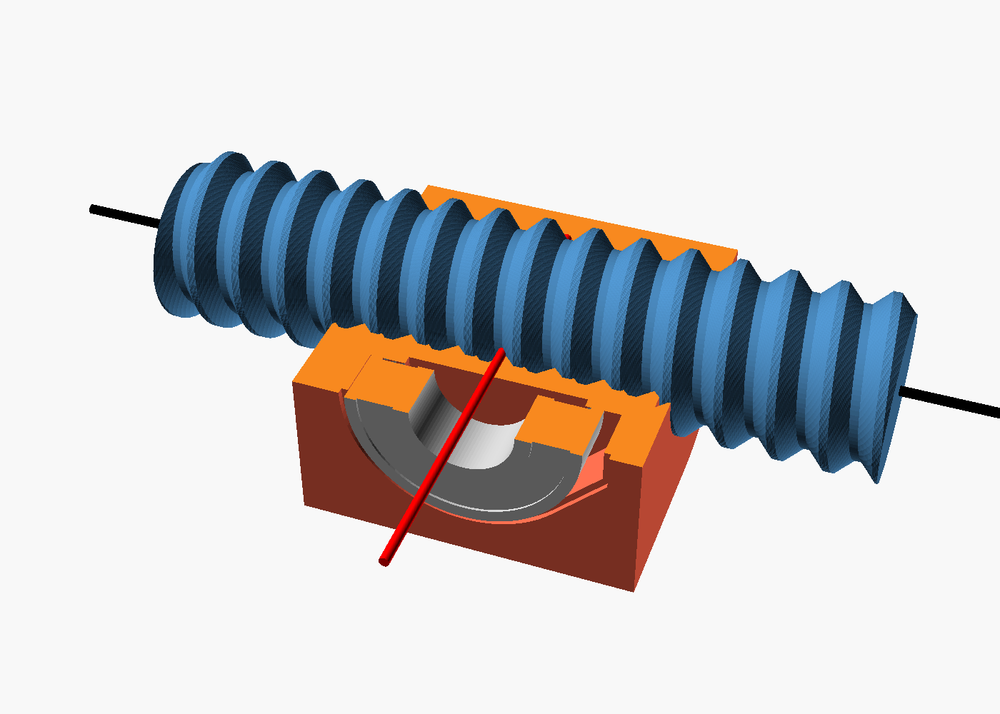

# Screw spreader / clamp (OpenSCAD)

A lead screw with a right-hand thread on one half and a left-hand thread on the
other. Turning the 3/8" square drive moves the two carriages toward or away
from each other. Everything fits a Prusa Core One (250 x 220 x 270 mm).

The cutaway (`section_view.scad`) shows the bearing axis (red) crossing the rod axis (black).

## Specs
| | |
|---|---|
| Rod length | 272 mm (10.7") overall, 250 mm threaded |
| Thread | 22 mm major dia, 6 mm pitch, 90° included angle (prints without support) |
| Travel | 6 mm per turn per carriage (12 mm/turn closing or opening) |
| Carriage centers | 42 mm (touching) to about 208 mm apart |
| Bearing | 1-1/8" OD x 1/2" ID x 5/16" wide (R8), press fit, axis perpendicular to the rod and through its center line |
| Drive | 3/8" square: fits the printed crank or any 3/8" ratchet or T-handle |

## Parts
Export with `openscad -o part.stl -D 'PART="rod_rh"' screw_spreader.scad`.

| PART | Qty | Print orientation |
|---|---|---|
| `rod_rh` (drive half, RH thread, hex socket) | 1 | standing up, square drive on top, brim |
| `rod_lh` (far half, LH thread, hex peg) | 1 | standing up, peg on top, brim |
| `carriage_rh` | 1 | as exported (thread axis vertical), no supports; the pocket has a teardrop top |
| `carriage_lh` | 1 | as exported |
| `crank` | 1 | flat |
| `knob` | 1 | upright |

Bought parts: 2x ball bearings 1-1/8" OD x 1/2" ID x 5/16" wide (R8 / R8-2RS),
1x M5x40 bolt and nylock nut, epoxy for the center hex joint. The 1/2" pins
that connect the bearings to your side members are not included.

## Assembly
1. Epoxy the hex peg of `rod_lh` into the socket of `rod_rh`. The glue is what
   holds the two halves together lengthwise.
2. Thread `carriage_rh` onto the RH half and `carriage_lh` onto the LH half,
   the same distance from center, bearing pockets on the same side.
3. Press a bearing into each carriage pocket. The
   bearing stands 0.5 mm proud of the face so the side member clears the
   carriage. A 1.2 mm relief behind the inner race keeps it from rubbing.
4. Pin each bearing to its side member. The pin must not go deeper than the
   bearing: there are only 3.5 mm of plastic between the pocket floor and the
   thread. The pinned side members stop the carriages from spinning.
5. Put the crank on the square drive.

Tune `CLR` (nut clearance, default 0.35 mm radial) if the carriages are too
tight or too loose on the rod, and `B_FIT` (default 0.15 mm) for the bearing press fit.
