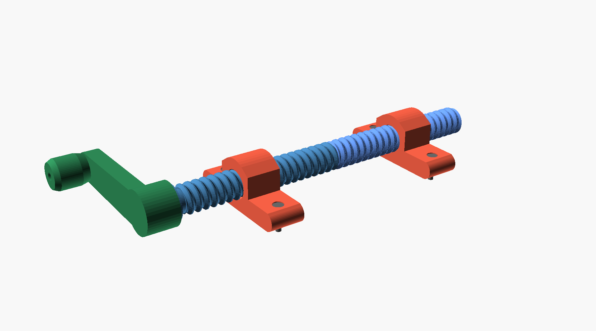
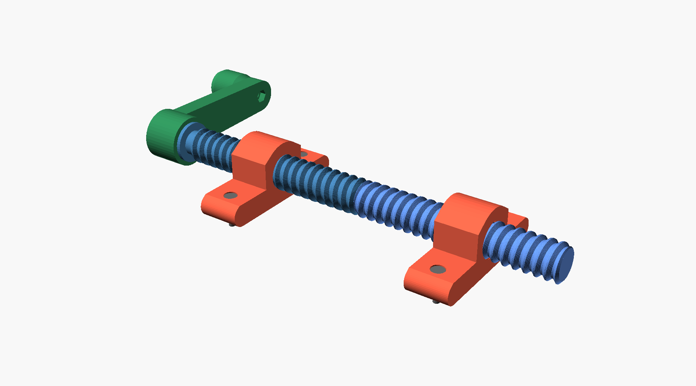
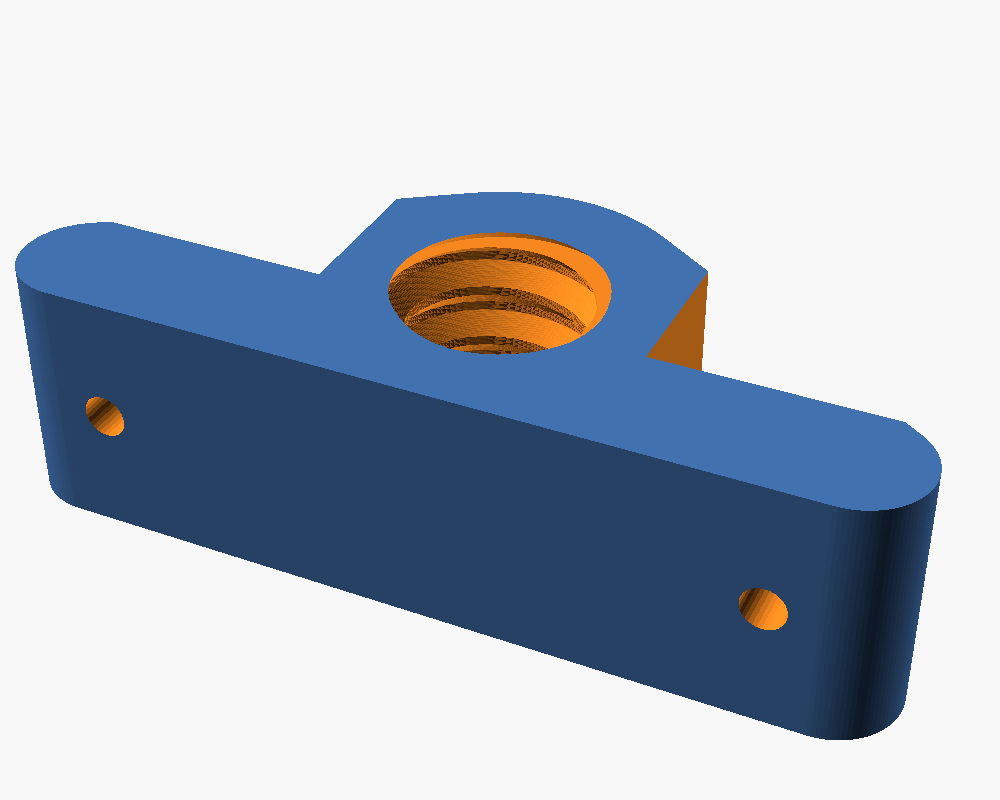

# Screw spreader / clamp (OpenSCAD)

A lead screw with a right-hand thread on one half and a left-hand thread on the
other. Turning the 3/8" square drive moves the two carriages toward or away
from each other. Everything fits a Prusa Core One (250 x 220 x 270 mm).

## Specs
| | |
|---|---|
| Rod length | 272 mm (10.7") overall, 250 mm threaded |
| Thread | 22 mm major dia, 6 mm pitch, 90° included angle (prints without support) |
| Travel | 6 mm per turn per carriage (12 mm/turn closing or opening) |
| Carriage centers | 26 mm (touching) to about 225 mm apart |
| Carriage mounting | 2 counterbored M4 / #8 holes per carriage, 68 mm apart, screws perpendicular to the rod through a flat mounting face |
| Drive | 3/8" square: fits the printed crank or any 3/8" ratchet or T-handle |

## Parts
Export with `openscad -o part.stl -D 'PART="rod_rh"' screw_spreader.scad`.

| PART | Qty | Print orientation |
|---|---|---|
| `rod_rh` (drive half, RH thread, hex socket) | 1 | standing up, square drive on top, brim |
| `rod_lh` (far half, LH thread, hex peg) | 1 | standing up, peg on top, brim |
| `carriage_rh` | 1 | as exported (thread axis vertical), no supports |
| `carriage_lh` | 1 | as exported |
| `crank` | 1 | flat |
| `knob` | 1 | upright |

Bought parts: 4x M4 or #8 screws (head 8 mm dia or less), 1x M5x40 bolt and
nylock nut, epoxy for the center hex joint.

## Assembly
1. Epoxy the hex peg of `rod_lh` into the socket of `rod_rh`. The glue is what
   holds the two halves together lengthwise.
2. Thread `carriage_rh` onto the RH half and `carriage_lh` onto the LH half,
   the same distance from center, mounting faces on the same side.
3. Screw the carriages to the parts you want to spread or clamp. Those parts
   keep the carriages from spinning with the rod.
4. Put the crank on the square drive.

Tune `CLR` (nut clearance, default 0.35 mm radial) if the carriages are too
tight or too loose on your printer.
